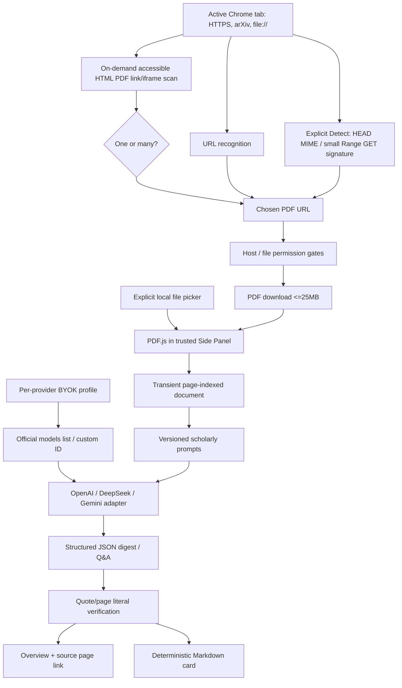

# PaperPeek technical architecture — v0.1.4

**Status:** code implemented, real website compatibility still under manual verification.

## System

## Source access / privacy boundary

`lib/urls.ts`: direct URL/source heuristics and safe scheme gates. `lib/detection.ts`: inject-able self-contained HTML discovery function, candidate normalization, MIME+bounded signature probe. `main.ts`: tab/source choice/permission state, explicit user actions and PDF lifecycle. `document.ts`: bounded fetch and PDF.js text extraction; parsing may not preserve complex reading order.

- URL and HTML discovery are **not LLM uploads**.
- Explicit Detect may request access to the current website and send HEAD / Range GET only to that site. Analyze fetches the selected PDF in full. Source protocol restricted to HTTPS or an explicitly authorized local file.
- File reading requires Chrome's file URL access toggle; no local path in prompt/export.
- Unknown/protected embedded PDF, POST-only response, blob URL and SSO may be impossible to re-fetch without viewer takeover; do not falsely claim otherwise.
- Avoid broad `webRequest` observation and auto-discovery of every browsed site in the background. Chrome 151+ MIME Handler remains a separately approved future option.

## Model/settings

`lib/provider.ts` calls official fixed HTTPS API endpoints. `GET /models` for OpenAI/DeepSeek returns candidate model IDs; OpenAI uses a heuristic to hide obviously non-chat models but catalog membership does **not** guarantee Chat Completions compatibility. Selected model ID is sent in each generation request. For Gemini the existing manual model ID route is unchanged.

`lib/storage.ts` stores a v2 selected provider + independent per-provider model/persist preferences in Chrome local storage. Keys are in per-provider session storage by default; the optional persisted map is local-only. One-time migration reads old `paperpeek.settings` and old key for **that provider only**, then deletes legacy entries. Clear-key operates per provider. No backend or PaperPeek account.

## Scientific prompts and data

`lib/prompts.ts`: versioned first-party prompt registry, shared bilingual terminology + source fidelity instructions, structured overview, bounded-history Q&A. The paper appears as explicitly marked **untrusted input**. Local file paths are omitted. `lib/digest.ts` only verifies an exact normalized quote on a claimed physical PDF page; semantic correctness still requires researcher review. `lib/markdown.ts` exports the same digest to a portable MD.

**Known performance limits:** 25 MiB max fetched PDF, 125k text characters for model context, 90s model timeout, non-streaming response, no RAG/OCR, no image-based figure explanation yet.

## UI / modules

- `sidepanel.html` and `src/styles.css` define a single compact source+action header; Overview/Ask/Card tab views.
- `src/main.ts` owns DOM + ephemeral paper/chat state and selected-source navigation.
- `src/background.ts` opens Side Panel and optionally passes context-menu text through session storage.
- `src/types.ts` supplies provider, paper and digest types.

See [Design System](design-system.md), [PDF support](pdf-support.md), [Prompt library](prompts.md), [Security](security.md) and [Testing](testing.md).

## Change contract

Changes to source discovery must update tests for file scheme, dynamic URLs, multi-PDF candidates and permissions. Changes to provider model lists must update tests and model compatibility caveats. Changes to prompt templates should bump `PROMPT_LIBRARY_VERSION` and be evaluated with human-reviewed papers, not just structural tests.

## Tab-scoped workspace and lifecycle (v0.1.4)

The previous version kept `paper`, `digest` and `conversation` in a single side-panel instance and cleared them on `tabs.onActivated`. PaperPeek now stores one `TabWorkspace` per Chrome tab ID in `src/lib/tab-workspace.ts`, backed by `chrome.storage.session`.

- Each workspace contains selected PDF source, page-indexed extracted text, digest, full conversation, unsent draft and last Overview/Ask/Card view. Markdown is deterministically regenerated from Paper + Digest.
- The active Side Panel captures the outgoing tab before restoring another. Cached workspace identity is checked against the current tab URL, permitting same PDF fragment and arXiv abstract-to-PDF navigation.
- Completed model results are bound by originating tab ID and Paper ID; updates mutate the original cache **before** awaiting storage, preventing a late tab switch from overwriting the result. Closed tabs reject late updates.
- Per-tab writes are serialized; gzip compression reduces PDF text's memory cost under the 10 MiB Chrome session quota.
- Service Worker and Side Panel use `tabs.onRemoved` cleanup. Workspace records contain no API keys or raw PDF bytes.
- Session storage is cleared on browser restart, extension update/reload and uninstall. It is an ephemeral reading state, **not** a persistent paper archive.
- Work in progress while Side Panel itself closes is not guaranteed to finish. Data already checkpointed remains available for retry.

See [tab sessions](tab-sessions.md) and [verification](verification.md).
